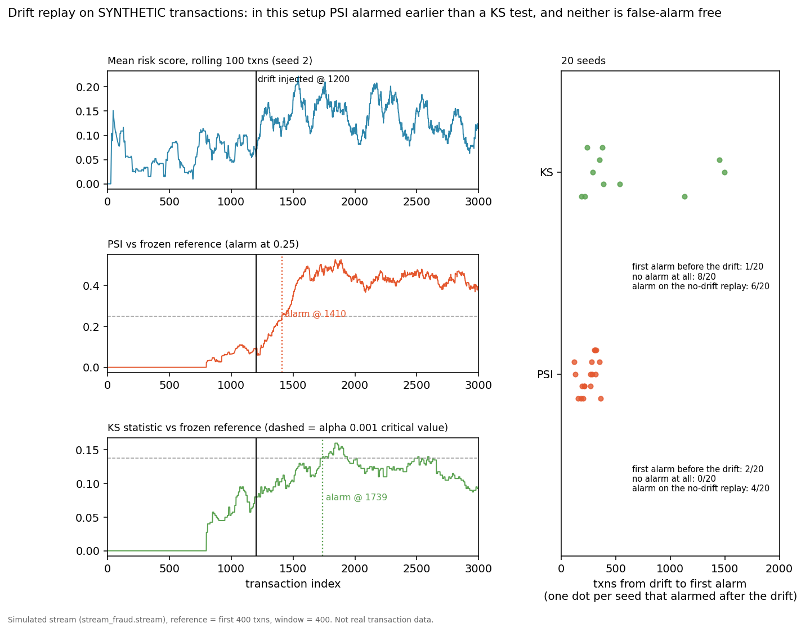

# stream-fraud

A pedagogical demo of a **real-time transaction scoring pipeline**: a
simulated card-transaction stream, sliding-window velocity features, an
interpretable risk scorer, and drift detection for when fraud patterns shift.

This is a teaching skeleton, not production infrastructure. Every piece is
pure Python stdlib — no Kafka, no Flink, no dependencies — so you can read
the whole thing in an afternoon and see how the parts fit together.

## The pipeline

```
TransactionStream → VelocityFeatures → RiskScorer → DriftMonitor
   (simulated)       (per-card sliding     (rules + z-score,   (PSI on score
                      windows: 5m/1h/24h)   0-1 + reasons)      distribution)
```

1. **Stream** (`stream_fraud/stream.py`) — generates legit traffic plus two
   fraud patterns: card-testing bursts (5–8 rapid small txns) and large
   cross-border txns. `inject_drift()` switches the fraud pattern mid-stream,
   simulating a ring changing tactics.
2. **Features** (`stream_fraud/features.py`) — per-card sliding windows kept
   in bounded deques: `count_5m`, `count_1h`, `amount_1h`, `amount_24h`,
   `distinct_merchants_1h`, `time_since_last_txn`. Memory stays flat no
   matter how long the stream runs.
3. **Scorer** (`stream_fraud/scorer.py`) — rules (velocity burst, amount
   anomaly via per-card Welford z-score, large cross-border txn,
   single-merchant hammering) producing a 0–1 score with human-readable
   reasons. A skeleton for a real streaming scoring service.
4. **Drift** (`stream_fraud/drift.py`) — tracks PSI (population stability
   index) of the score distribution between a frozen reference window and a
   rolling current window. PSI ≥ 0.25 → drifted.

## Quickstart

```bash
python -m venv .venv && .venv/bin/pip install pytest
.venv/bin/python -m pytest tests/ -q
PYTHONPATH=. .venv/bin/python examples/quickstart.py
```

Expected output: ~2,000 txns scored in well under a second (~10µs/txn),
fraud detection around 50%+ at ~0% false positives with the rules baseline,
and the drift monitor firing a few hundred txns after the pattern switch.

## Drift replay and a second detector (experimental)

`stream_fraud/ks.py` adds `KSMonitor`, a two-sample Kolmogorov-Smirnov test on the score
distribution with the same `update()` / `check()` interface as `DriftMonitor`. It is an
experimental option for comparison, not a replacement for PSI. Its `alpha` is the level of a
single test; the monitor repeats the test on overlapping windows of bursty scores, so `alpha` is
not the monitor's false-alarm rate. Measure that on no-drift replays.

`stream_fraud/replay.py` replays a stream with drift injected at a known transaction and records
when each detector first alarms. `examples/drift_replay.py` draws the figure below
(needs `matplotlib`; the library stays stdlib):



```bash
pip install matplotlib && PYTHONPATH=. python examples/drift_replay.py
```

All data is synthetic. Seeds 1-20, drift at txn 1200, reference and window 400. On this setup, over
those 20 seeds, PSI's first alarm came 121-362 txns after the drift in 18 runs. KS alarmed after the
drift in 11 runs (189-1499 txns), never alarmed in 8, and PSI/KS each alarmed on the matching no-drift
replay in 4/20 and 6/20 seeds. Every seed is in the figure. A first alarm before the drift point counts
as an early alarm (PSI 2/20, KS 1/20), not a detection. Small windows and a bursty score stream make
both detectors noisy; this is a teaching comparison, not a tuned benchmark.

## Interactive drift demo

`docs/drift-demo/` builds a self-contained "Catch the drift" page: watch the scored stream play
out, guess where the fraud pattern changed, then reveal when PSI and KS actually alarmed on that
seed. Rebuild it from the real replay code (stdlib only):

```bash
PYTHONPATH=. python scripts/build_drift_demo.py   # -> docs/drift-demo/index.html
```

Open the generated file in any browser; there is nothing to install. Every series in the page is
regenerated from `stream_fraud.replay` on each build, and `tests/test_drift_demo.py` fails if the
embedded data ever disagrees with the library.

## Cost-aware thresholds

A fixed 0.6 flag threshold treats a $3 card-test and a $3,000 chargeback
as equally worth catching. `CostAwareThreshold` (see
`stream_fraud/threshold.py`) replaces it with a dollar-driven one: it
buffers labeled (score, is_fraud, amount) observations — the delayed
label feedback a streaming system actually gets — and sweeps candidate
thresholds for the cheapest total cost:

- flagged fraud → analyst confirmation ($2)
- flagged legit → review + customer friction ($8)
- missed fraud → the full transaction amount

`examples/cost_threshold_example.py` compares default, F1-optimal, and
cost-optimal thresholds before and after the drift injection. With cheap
card-testing fraud, the tuner picks a precision-first threshold (0.55)
that F1-optimal would overrule with 500+ expensive false positives;
with $900–4,000 chargebacks, it converges with F1 at 0.55 and beats the
stale fixed baseline by ~$1,400 per 6,000 txns.

## What's deliberately missing (roadmap)

- [ ] Kafka/Flink adapter replacing the simulated stream
- [ ] Online learning: scorer that retrains incrementally as labels arrive
- [ ] Feature store (offline/online parity) instead of in-memory deques
- [x] Cost-aware thresholds: tune the flag threshold by $ loss, not F1 —
  `stream_fraud/threshold.py` (`examples/cost_threshold_example.py`)
- [ ] Multi-pattern drift: detect *which* pattern shifted, not just *that* it did

## Not for production

Amounts, merchants, and fraud patterns are synthetic. The scorer is a
rules baseline — a real system would use a trained model, proper label
feedback loops, and adversarial review. Don't point this at real money.
